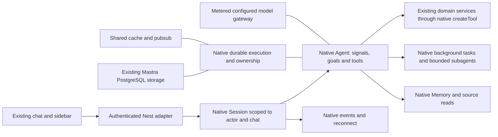

# Native Mastra assistant: integration design and implementation plan

**Epic:** `content-factory-next-on0i` (existing identity/history retained).
**Owner direction, 19 October 2026:** prepare this epic and its handoff first;
implement the complete product in a new chat with **Gemini Argon as executor**;
local verification, no deployment. Product model selection is a separate concern.
**Goal:** use native Mastra to operate the assistant from message receipt through
planning, tool execution, durable completion and user interaction, with the model
choosing the work and product services enforcing access and side-effect safety.
**Approach:** upgrade the compatible native SDK family, then integrate the
existing agent, memory, tools
and product data. Replace duplicate orchestration in consumers; do not build a
parallel harness. A native capability counts as integrated only when the actual
product entrance uses it and a result survives its required failure paths.
**Status authority:** Linear through Beads; this is a design/acceptance contract,
not another status ledger. Beads children own implementation status.

## 1. Evidence and limits of the preparation

The implementation baseline is local commit `29d98372f4650e7d42bbcb1bb014741351d95cd7`
in `/home/me/code/content-factory-next-worktrees/j9p5-model-led-20261018`.
Preparation branch: `codex/on0i-native-harness-plan-20261019`.
The original checkout is on another branch with unrelated modified documents;
do not reset or copy over it. The already-tested sidebar change is in the
baseline (`ff3a06e1b`); preserve it. No newer production claim is made here.

Installed versions checked locally: core **1.71.0**, memory **1.32.1**, pg
**1.27.1**, ai-sdk **1.10.5**; MCP1.18.0, CLI1.3.19 and a resolved server1.21.0.
**Revised target:** core1.78.0 is npm latest stable on19October, and its useful
delta makes an in-epic upgrade worthwhile. Task1 owns coordinated package and
old-data/API migration before native consumer work. Registry candidates: memory
1.38.0, pg1.31.2, ai-sdk1.11.1, server1.78.0 and CLI1.34.2; optional official
client/observability/cache packages need real consumers. MCP2.4.1 is a public
protocol major change, not an automatic peer bump: preserve supported client
contracts and decide it in Tasks1/7. Current MCP1.18 is peer-compatible with
core1.78 if legacy protocol support requires retaining that adapter.
Recheck stable tags at implementation entry, pin exact coherent versions and
read intervening migrations if a newer stable is selected; do not use alpha as
the default or treat registry peers as a successful runtime upgrade. Node22.23.2
meets the returned>=22.13.0 engine requirements. The detailed review is retained
in `.codex/stages/content-factory-next-on0i-native-harness-20261019/upgrade-and-argon/release-review.md`.
The earlier private audit and four offline native probes in
`.codex/stages/content-factory-next-2512-native-harness-20261019/` remain evidence
of API availability, not completed product integration.

Observed failure: useful-looking research rows were returned, two tool results
contained 476330 characters, a large intake operation was entered again, and
our 540000ms deadline ended the request with an uncertain result. The pipeline
labelled seven facts confirmed; their quality/novelty was not independently
established. There were 22 provider observations and 377818 accounted tokens.
The configured text roles all resolved to `openai/gpt-6-luna`; no complexity
selector was active. This is one regression sample, never a template for
hardcoding one topic, date interval, provider or user's wording.

The previous full local run passed build/types, Jest12626 and Node126; Python
passed50 after a documentation-only correction. The original combined run
failed and wrote no release receipt. New implementation requires fresh checks;
neither those receipts nor the four probes certify its product behavior.

## 2. Product behavior and ownership of decisions

The assistant understands an original message, supplied material, authorized
history and current saved artifacts. It may answer directly, research, read
sources, compose or revise an artifact, ask for a missing fact, plan work,
delegate a bounded task, or wait for a real approval. It chooses a useful order
rather than following a prescribed intake/research/write sequence.

| Model decides | Product/runtime guarantees |
| --- | --- |
| Whether search is needed, queries, evidence relevance and sufficiency | Authorized provider/tenant context, truthful receipts and original evidence |
| Whether input is instruction, material, example, reference or a mixture | Original input/provenance survives; source content cannot become trusted policy |
| How to compose existing research and writing tools | Valid schemas, revision checks, persisted outcomes and no duplicate writes |
| Whether missing information needs a question or a reasonable assumption | Only the person supplies their private/business facts and approves consequential actions |
| Whether a task benefits from a plan, background work or delegation | Native lifecycle, scoped permissions, accountable model/tool calls |
| Whether a result fulfills the request | Completion references actual saved artifacts; a timeout/paused goal is not success |
| Complexity/capability selection among configured models | No unconfigured provider/credential switching; selection is observable and metered |

Preserve explicit user constraints such as no search, no publication, selected
language, target channel and effective date. Remove semantic regex/phrase maps,
mandatory previous-post assumptions, universal one-question templates and
forced service sequences. Do not substitute a new deterministic semantic router.
Validation of identity, ownership, schema, revision, actual quotas, secrets,
approvals and write receipts remains code: a language model cannot replace it.

## 3. Target runtime and durable data



### Construction and ownership

`MastraService` remains the Nest integration facade, not a second runtime.
Use native `AgentController` and register it through the supported
`Mastra({ agentControllers: ... })` path. Check whether the controller's internal
host is adopted by that registration in the pinned version. There must be one
owner for storage, durable recovery, scheduler, background-task manager and
shutdown; do not initialize two competing hosts around the same agent.
SDK-managed internal instances are allowed: this is a lifecycle/consumer
requirement, not an object-count rule. Do not hand-wire private SDK fields to
force a singleton that the public integration does not require.

The installed `Agent` supports `durable: true`; attachment to Mastra performs the
native durable wrapping. Prefer this composition when passing the backing Agent
to `AgentController`, rather than casting an incompatible wrapper into its
`agent` slot. `createDurableAgent` is also public. Task1 must prove the exact
Controller/Agent/durable/context composition before migrating consumers.

Use native1.78 Agent scopes derived from trusted server identity and preserve
existing resource/thread IDs. Reject mismatching native and legacy bindings;
do not accept scope/role injection or widen scopes on resume. Agent scopes are
labels/bindings, not a replacement for authorization. Session.scope is a
different per-chat runtime key. Authenticated message authors come from the
server, not the model or user text.

Use server-owned `conductorResourceId(org,user)` and a stable **per-chat**
Session scope/id. One resource may have many chats and active tabs; a single
mutable Session for the whole resource can send a turn into another chat.
`createSession({ resourceId, ownerId, scope, threadId, requestContext })` has
get-or-create behavior. Verify binding on every entrance and on recovery; a
client supplies selectors, never authority. Preserve existing thread IDs and
history; sidebar listing remains resource-scoped and paginated.

### Durable state and recovery

Use native PostgreSQL workflow snapshots and supported persistent cache/pubsub
(existing local Redis is a candidate adapter, not an invented event store).
Use native run ownership and recovery APIs. With the installed SDK, running
checkpoints require the supported snapshot policy; choose and test
`recovery.durableAgents: 'auto'` or deliberate manual recovery through
`listActiveRuns` / `recoverActiveRuns`. Resume suspended calls through the native
resume path, not by submitting the original message again.

A disconnected browser detaches an observer. User Stop aborts the run. These
are different operations. Keep replay data until the run's lifecycle permits
cleanup, including suspended approvals; do not call destructive cleanup when
one HTTP observer disconnects. Final results remain retrievable after a process
restart. Background results must be associated with the original resource,
thread, task and run, including late completion after cancellation.

Mastra recovery can replay model/tool calls, including an entire delegated
agent. Keep stable operation identities, product write journals and provider
uncertainty handling at side-effect boundaries. A committed artifact is read
back; an uncertain external write is reconciled, never blindly retried. The
native framework does not provide business-level exactly-once publication.

### Native evidence and context

Full sources and tool results stay in existing native Memory or an authorized
Workspace-backed evidence view, with stable provenance and revision identifiers.
Use `toModelOutput` for the model-facing representation: outcome, summary,
facts/gaps, all source references and an actionable read reference. Expose an
owned source/tool-result read capability with ranges/pagination. Existing
`conversation-history.ts` reads text only. After the upgrade first use native
`context.agent.getMessages()` for the active conversation, native observational
history group/record navigation and `viewAttachment` for retained image/PDF
content. Add only the missing authorized saved-source/revision read path; do not
reimplement native history or assume a text description exposes the actual file.

Do not add a second transcript database, silently keep only the first N facts,
or move unrestricted files into a shared filesystem. Apply `ToolCallFilter`
and, where needed, request-only `processLLMRequest` transforms so native storage
and UI retain original results. Use native observational/working memory for long
context with a configured metered auxiliary model; original instructions,
source IDs, pending approvals and artifacts must remain recoverable. A token
limiter is a last context guard; it cannot silently turn incomplete work into
success or replace source reads.

## 4. Native capability coverage

This covers the full documented harness surface and adjacent SDK facilities
needed by this assistant. Disposition is explicit: **integrate** in this epic,
**retain/adapt** an existing native path, or **conditional** when no current
consumer exists. Listing a facility does not justify enabling unrelated shell,
voice or external channels. Each integrated row must have a real product
consumer and a local scenario; conditional facilities must not get counterfeit
implementations merely to make a checklist green.

| Native facility / public API | Current position | Integration and owner |
| --- | --- | --- |
| `Agent`, model tool loop, `createTool`, schemas and hooks | Already used | Retain; composable domain tools with original task and verified outcomes (Tasks1,2) |
| `AgentController`, `Session`, dynamic tools/state/model | Not used | Stable SDK upgrade and one interactive host; native no-initial-thread support; updated per-thread model switch API (Tasks1,6) |
| Agent1.78 scopes and authenticated message authors | Not used | Server-derived bindings, conflict refusal, non-widening resume, scoped delegation; keep product authorization (Tasks1,3,4) |
| Native thread create/list/switch/rename/delete/clone, Memory | Native storage with custom service wrapping | Keep identifiers and access checks; delegate lifecycle to Session, preserve pagination and unsent drafts (Tasks1,6) |
| `session.sendMessage`, `queueMessage`, `followUp`, `steer`, `abort`, events | Mostly custom HTTP lifecycle | Wire explicit UI actions to native controls; no text keyword dispatcher (Tasks1,6) |
| Signals and typed `queueSignal` | Not integrated | User input uses message APIs; preserve type/tag/attributes for queued system context instead of turning it into user text (Tasks3,4,6) |
| `Agent({ durable: true })`, `createDurableAgent`, `observe`, recovery APIs | No product durable run | Persistent snapshots/cache, owner-safe recovery and reconnect (Tasks1,3) |
| Native background manager, tool `background`, `untilIdle` | Not integrated | Slow research/delegation without tying execution to one SSE connection; propagate actual completion through `fullStream` (Task3) |
| Thread goals: `setObjective`, `goal.judge`, read-only verification tools | No durable objective | Native objective/judging for actual multi-step goals, opt-in by model/task need; pause instead of false completion on budget exhaustion (Task4) |
| `ask_user`, `submit_plan`, `task_write/update/complete/check` | Custom questions; no native task tracking | Register native built-ins once; model chooses when needed. Avoid duplicate TaskSignalProvider/controller task tools (Task4) |
| Native approvals, `beforeApproval` and `suspend` / `resume` | Already partly native with product checks | Validate before showing a card, return invalid input to model; recheck rights/content in execute after response; preserve old pending calls (Tasks1,4,6) |
| Controller `subagent` or native supervisor `agents` tools | No product delegation | Choose one public delegation surface, bounded research/writing/review specialists, inherited scoped context and permissions; no parallel custom router (Task4) |
| `createSkill`, skill loading / Workspace skills | Native group skills already used | Replace rigid procedural instructions with task knowledge and clear tool descriptions; preserve progressive loading (Tasks2,4) |
| `toModelOutput` | Adapter exists but research summary copies raw output | Real compact model view, full evidence retained/readable; no source top-N semantics (Task2) |
| `ToolCallFilter`, `processLLMRequest`, `TokenLimiter` | Only custom processors for secrets/images | Add context controls without altering durable originals or pending native parts (Task2) |
| `ToolSearchProcessor` | Not used | Native search/load over the authorized capability catalog; approval and read tools stay discoverable. Use when catalog size warrants it (Task4) |
| `Memory`: history, atomic working-memory merge, Observational Memory | Native history; custom read adapter | Adopt supported PostgreSQL merge/generation semantics; native auto auxiliary models stay metered/configured. Semantic vector recall is conditional on an actual retrieval need (Tasks2,5) |
| Native conversation/history and actual attachment recall | Custom text-only history and viewed-picture bridge | `getMessages`, group/record history navigation, `viewAttachment`, and supported file recovery before adding an authorized domain-source bridge (Task2) |
| `Workspace` files/search/RAG | Product objects, not a general file workspace | Owned evidence/source view is a concrete consumer. Reuse native read/search where suitable; product DB remains source of truth. No exposed host filesystem or automatic shell (Task2) |
| `ModelSelectionProcessor`, configured classifier | Available, inactive | Native confidence-based selection with abstention to configured capable default; configurable choices/roles; no regex difficulty rules (Task5) |
| Native model fallback arrays, gateways and switching | Existing single fallback setting and restricted transport chain | Configure ordered eligible models and retry policy through existing AI settings; use native fallback arrays, preserve provider/key scope, account for every main/auxiliary attempt (Tasks1,5) |
| Error/history/file/retry processors, StreamErrorRetryProcessor | Framework defaults plus product transport | Native transient retries with backoff/Retry-After and explicit attempt accounting; coordinate processor/model/transport budgets, Stop and partial streams. `maxRetries:0` alone does not disable processor retries (Tasks1,5) |
| Observability, querySpans/aggregateTraces, previews, scorers/evals | Custom usage/runtime journals | Native queries/coverage-aware cost measures and linked spans replace custom trace queries; redact data and keep real usage receipts, not price estimates as invoices (Tasks5,7) |
| Native `mastra.schedules.create/list/update/delete`, `defineSchedule` and scheduler lifecycle | Temporal owns existing product schedules | Integrate only explicit agent follow-up schedules with native storage/timezone/cancel controls. Never migrate social publishing schedules or immutable Temporal contracts (Tasks3,4) |
| `SignalProvider` / `WebhookSignalProvider`, task state signals | Available | Native internal delivery and task state are integrated. New external watchers need a real connector/authorization; no parallel polling loop or duplicate task provider (Tasks3,4) |
| SDK streaming adapters, `@mastra/ai-sdk`, assistant-ui integrations | Existing SDK UI and product components | Preserve current shell and native stream support; adapt events/cards/reattach. A UI toolkit is available, not a requirement to rewrite a working UI (Task6) |
| MCP client/server and shared tool export | Existing Mastra MCP adapter | Preserve capability registry/schema/auth for both entrances; no separate business tool implementation or unguarded MCP path (Tasks2,7) |
| Native workflows, suspend/resume and storage | Native/Temporal have existing consumers | Use durable agent's native workflows internally; keep existing domain workflow versions and receipts (Tasks3,7) |
| Channels/connections/browser/sandboxes/Code Mode, `createCodingAgent` | Available extension points, no new authorized connector or coding use case | Conditional: document supported integration points; do not enable host shell, external messaging, arbitrary code or replace this content assistant with a coding agent |
| Studio, vector stores/RAG, audio/voice and deployment adapters | Framework facilities outside this runtime migration | Existing surfaces remain; no new platform product, vector infra or deployment. Native API metadata/Studio may assist local diagnosis with authentication and no public exposure |

Primary sources are listed in section12. The installed declaration evidence is
saved with this preparation; latest docs are not authority to invent an absent
method in the selected target. Earlier1.71.0 probes do not certify1.78 integration.
Experimental APIs need version-bound compatibility tests.

## 5. Replace, retain or narrow: current custom logic

| Current code / behavior | Decision and replacement | Required evidence before removal |
| --- | --- | --- |
| `apps/backend/src/api/routes/agent.controller.ts`: stream driving, manual approval legs, final/silence watches | Thin Nest identity/request validation and stream/event adapter over native Session | Actual POST, suspension/resume, Stop, failures and reconnect preserve UI/history/usage |
| `chat/conductor/agent-threads.service.ts`: manual thread/run controls | Native thread/session/run APIs; keep product ownership and compatibility adapter | Same IDs/history, two users/orgs, pagination, two active chats, old pending approval resume |
| `chat/conductor/agent-run-claims.ts`: fixed600s ownership | Native distributed run ownership and lock/recovery integration; keep only a proven thin business lease if SDK does not cover it | Two processes cannot drive the same turn; a task can exceed nine minutes safely; restart and expiry race |
| `conductor.execution.ts`: lifetime derived from claim TTL | Native durable lifecycle, configurable technical fuses, explicit partial/paused state | No forced540000ms stop, no invented zero/infinite-cost guarantee, no success on a fuse |
| Global `toolCallConcurrency:1` and single paid in-flight slot | Allow independent reads via native concurrency/background controls; side effects use keyed admission/journals | Parallel independent work, ordered dependent writes, terminal accounting, no duplicate publication |
| `conductor.steps.ts` and HTTP closing templates | Native run/goal/tool states; smallest transport compatibility mapping only | Never silent after failure, never fabricate a final result, no forced text-only last step |
| `conductor.instructions.ts`: one-question template and procedural restrictions | Outcome/constraints-oriented instructions and native question/plan/task tools | Model asks only material questions; can answer/choose/research/compose with varied input |
| Large `piece.create` / `piece.create.from-research` / research-writing paths | Small composable capabilities over existing Intake/Piece/Derivation services; pass saved research/provenance | Reuse completed research, no repeated intake/search forced by writing, artifact matches UI |
| `catalogue/research.capabilities.ts`: `summarize => {...output}` | Native `toModelOutput` plus owned evidence read | Full source99 recoverable; model sees all source refs without all bodies |
| `conversation-history.ts` text-only access and `conductor.pictures.ts` media bridge | Prefer native getMessages/history/viewAttachment; retain only a proven domain/media bridge | Full owned source/media and original instruction retrievable, no duplicate transcript or lost attachment |
| `ai.roles.ts`, clients/text-chain, fixed Luna medium effort and flex/fallback defaults | Native configured model choices, ordered fallback arrays and one retry policy; retain metering and thin provider compatibility only; migrate existing fallback setting | Main/auxiliary attempts, settings roundtrip, fault recovery, Stop and full task cost observable; no duplicate retry chain |
| Secret/image processors, CASL/doors, approval fingerprints/content digests, write journals | Retain minimal domain invariants or adapt through native hooks | Tampered identity/content, stale revisions, cross-tenant access, secret echo and uncertain writes refused |
| Transport/provider input-size, enum, date and concurrency constraints | Classify provider/security constraints versus semantic preferences; move provider specifics into providers | No deletion merely because a numeric bound exists; every retained bound has an actual contract and consumer |

This is an initial confirmed map, not a claim that every listed file can be
deleted wholesale. Each owning task audits its actual callers (web, MCP, manual
screens, background and recovery), removes obsolete branches/imports/config and
records any necessary retained adapter with its consumer and reason. Additional
semantic phrase/routing gates found in intake, research, writing or instructions
are in scope; provider/service invariants must be distinguished explicitly.

## 6. Integration contracts

- **Identity:** only the authenticated server establishes org/user/role,
  resource and capability context. Rehydrate on background/recovery/schedule
  execution and re-check current membership/permissions before spending/writing.
  Never persist raw credentials inside snapshots or trust a serialized role.
- **History:** existing native thread/message identifiers remain usable. Scope
  Session by active chat; new chat, selection and draft retention keep the
  standard sidebar pattern. Navigation does not launch a new paid task.
- **Events:** explicit running/waiting/completed/failed/paused/stopped states,
  task/goal progress and usable artifact references come from native events and
  real domain outcomes. `untilIdle` aggregate `text` is not the whole multi-turn
  result: consume native `fullStream` for continuations.
- **Control:** ordinary message, queued follow-up, steering and Stop have native
  routes/actions. No special text such as a particular localized “continue”
  command is needed to reconstruct a task; use original goal/history/artifacts.
- **Approvals:** native ask/suspend/approve/decline is the mechanism; exact
  consequential action/content and actor rights are domain checks. A native
  `always_allow_category` or yolo option cannot bypass required product consent.
- **Provider execution:** one task/request lineage links every main/auxiliary
  generation and search call. No double charge on replay, no zeroing unknown
  costs, no duplicated retry/fallback owners; configured role/model choice is
  an input, never a hardcoded model ID in semantic routing.
- **Scheduling:** agent follow-ups use explicit timezone (account setting,
  otherwise user-visible Europe/Moscow assumption), native owner/context and
  cancel controls. Existing Temporal social schedules remain separate.
- **Local environment:** fresh owned local PostgreSQL/Redis and synthetic
  organization/channel data. Reject production DB targets before initialization.
  Existing authorized provider settings may be used only through already
  available local credentials; never copy production secrets as a hidden step.

### Automatic retry and model fallback contract

Availability recovery is separate from complexity-based model selection. The
model chooses the work; native runtime/provider mechanisms recover failed model
calls using operator-configured eligible models. Do not require another user
message for ordinary transient failures or restart the whole task to retry one
failed generation. This extends the existing Task5, with recovery/UI integration
in Tasks3/6 and default-path acceptance in Task7; no additional epic or harness.

Current source has one instance-admin `textFallbackModel` field and a legacy
transport chain restricted to included/OpenRouter calls. An empty field restores
a hardcoded default; it cannot explicitly disable fallback. Reuse that settings
entry and persist an ordered chain plus a deliberate retry policy with the same
configuration authority as the primary model. Preserve old saved values on
migration; distinguish inherited/default settings from an explicit empty list.
The UI supports add/remove/reorder, shows the effective eligible chain and
unavailable-entry reasons, and retains its values after save/reload. Include the
policy in existing provider/session cache fingerprints so the next task uses
saved changes without a process restart; revalidate eligibility before another
attempt or recovery and never persist credentials with the policy. Do not
silently extend included credits or borrow another tenant/provider credential.
For own-key mode, fallback works among models authorized and compatible with
that key/provider; unavailable credentials cannot trigger an unconfigured key.

Use native `Agent` model arrays (`{ model, maxRetries }`) and the selected
version's `StreamErrorRetryProcessor`/repair processors. Set a coherent total
attempt policy across model retries, processor retries (`maxProcessorRetries`),
SDK/gateway/transport fallbacks and auxiliary roles; explicitly supersede old
fetch-level retry chains when native consumers are ready. Respect bounded
Retry-After/backoff and cancellation. No new hand-written retry loop, polling
queue, fixed model name or hardcoded task-wide financial ceiling. Check actual
selected-version exports/behavior rather than assuming documentation equals
runtime proof. A healthy call does not fall back merely because it is expensive.

Retry transient rate limits, provider errors, network resets/timeouts and
interrupted streams according to native/provider semantics; move through the
configured eligible chain when needed. Repair malformed history/files/input
through native processors before another unchanged call. Persistent auth/input
errors need a meaningful alternative or an actionable pause, not identical
retries. Access denials, Stop, quota exhaustion and missing consent cannot be
converted into a model-availability workaround. Preserve tool/structured-output,
context and attachment requirements when choosing a fallback; no silent loss of
required capabilities or mandatory second classifier for every failed attempt.

Keep the same goal/thread, completed tool results and operation identities.
Persist run ownership and recovery state; a restart during retry/backoff cannot
restart a whole research/write operation. Partial output is not a completed
answer; native retry/stream parts reconcile in one visible turn without merging
contradictory answers. Never replay an uncertain consequential write blindly.
The primary agent and in-scope classifier/judge/memory/subagent/domain model
calls share this policy and lineage, including failed/possibly billed attempts.

If all eligible models remain unavailable, retain progress and show a waiting
or paused state with reason and next recovery condition. Use supported native
wait/recovery/scheduling facilities to resume the existing task automatically
for recoverable outages; bound request attempts and recovery delays, and test
process restarts and ownership. Do not add a custom scheduler or tight retry
loop, erase progress, mark the task done, or promise success while dependencies
are unavailable. Stop cancels future retries/recovery as well as the active call.
Operator controls expose the effective chain and policy; routine users receive
clear progress without provider configuration jargon in the conversation.

## 7. Cohesive Beads implementation tasks

All children remain OPEN after preparation. Each includes its implementation,
consumer wiring, focused regressions and durable docs. Ordering is dependency
information, not a coded workflow the content model must follow.

### Task1 — Stable SDK upgrade and native isolated sessions (`on0i.1`)

**Boundary:** Nest/SDK public contract and identity isolation. Separate because
all later runtime work consumes its session and context contract.
**Files:** root `package.json` / `pnpm-lock.yaml`, actual used Mastra CLI/server
adapters, `libraries/nestjs-libraries/src/chat/mastra.service.ts`,
`chat/conductor/conductor.agent.ts`, `conductor.context.ts`,
`agent-threads.service.ts`, `apps/backend/src/api/routes/agent.controller.ts`;
new small `chat/conductor/native-controller.ts` only if a facade is needed.
**Consumes/produces:** original message + server context -> native Session/run,
stream and thread binding; preserve existing HTTP client compatibility.
**Dependencies:** none; use the existing provider admission until Task5 adopts
selection. Do not wait for a new provider to prove native control.

First select/pin the latest stable compatible bundle (reviewed core1.78.0),
review the full1.71-to-target changelog and adapt used imports/contracts. Align
all actual server adapters; custom Nest does not get scopes compatibility merely
by updating core. Migrate/read old native-history/pending-call fixtures on an
owned local PostgreSQL DB and record schema/API differences. Handle MCP major
protocol compatibility explicitly within this epic. Then prove
controller registration/durable composition, one host lifecycle and
per-chat scope with the real installed library and scripted model. Then wire
actual product send/thread/control entrances, ownership and native events.
Keep dynamic context/model resolution and existing usage admission. Use trusted
Agent scopes/authors; prevent conflicting bindings and wider scopes at resume.
Adopt createInitialThread:false and ensureId on actual send to avoid empty chats.
Use the target per-thread model switching signature. Reconstruct
Sessions from persisted owned threads; do not assume JS objects survive restart.
**Acceptance:** coherent stable bundle/build/types and pre-upgrade native data
fixtures pass; actual used server and MCP contracts are compatible; no scopes
injection or widening. Two users/two orgs/two simultaneous chats cannot mix state,
messages, model overrides or approvals; existing thread IDs and pending native
parts remain readable. Real product route uses Session, not a probe-only host.
**Focused checks:** existing `agent-conductor.*`, `agent-native-history`,
`agent-chats-pagination`, `agent-work-context`; add actual two-session/two-chat
API behavior to the existing native harness fixture infrastructure.

### Task2 — Compact evidence and composable domain tools (`on0i.2`)

**Boundary:** research/intake/writing and persisted provenance. Independent of
HTTP/UI; can be implemented once Task1's identity contract is settled.
**Files:** `chat/capabilities/catalogue/research.capabilities.ts`,
`piece.capabilities.ts`, `material-read.capabilities.ts`, `mastra.adapter.ts`,
`capability.types.ts`, `chat/conductor/conversation-history.ts`,
`conductor.memory.ts`, `conductor.instructions.ts`, relevant existing
content-intelligence intake/piece/derivation services; no duplicate repositories.
**Dependencies:** Task1 for context contract, or coordinate the unchanged
resource schema when implementation can remain independent.

Prefer native getMessages, observation group/record navigation and actual
attachment recall; migrate redundant history/image handling only with equivalent
privacy and content behavior. Verify PostgreSQL atomic working-memory merge,
empty extraction preservation and observation/reflection generation races.
Implement `toModelOutput` and read-on-demand against real native Memory/Workspace
and saved research revisions. Model chooses searches and writing order; writing
can consume already-known research without new interpretation/retrieval by
construction. Integrate native history filtering/compaction/working memory;
configure memory auxiliary calls through the same metered adapter. A schema-valid
partial finding is not a quality certificate and is not a mandatory question.
**Acceptance:** all evidence retrievable, original input exact, no hidden
semantic top-N, no repeated completed research for an unchanged task, retained
sources do not flood each model call, saved draft/adaptation usable on screens.
**Focused checks:** `agent.model-intake-composition`, `agent.content-material-echo`,
`agent.model-autonomy`, `agent-native-history`, source/research fixture contracts;
include giant tool output, exact citations and selective full-source reads.

### Task3 — Durable background execution and safe recovery (`on0i.3`)

**Boundary:** process lifetime, shared storage, claims and side effects.
**Files:** `mastra.service.ts`, `conductor.agent.ts`, `conductor.execution.ts`,
`agent-run-claims.ts`, `agent-turn-lifecycle.ts`, run/thread repositories and
existing `openai/ai.usage.service.ts` / `ai.text-chain.ts` observers; local fixture
startup/config and backend shutdown lifecycle.
**Dependencies:** Tasks1,2; Task2 provides stable saved-result references.

Adopt persistent durable snapshots/cache/pubsub, native distributed ownership,
background tasks and until-idle events. Explicitly enable native
`recovery.durableAgents: 'auto'`, persist running checkpoints and wire the actual
Nest bootstrap/recoverAllDurableAgents lifecycle; a custom server cannot assume
the deployer's startup hook runs. This recovers orphaned running work, not every
terminal failed run. An exhausted provider chain needs a supported durable
wait/retry/resume transition before terminal failure, not orphan recovery or a
blind replay of the whole task. Exercise new native ownership renewal
and storage run fencing with a stale driver as well as a crashed one.
Disconnect detaches; Stop cancels. Use
native storage/recovery rather than extending fixed600s claims. Re-register
background executor context when the pinned resume API requires it. Persist
operation identities and keep all existing committed/uncertain write receipts.
Recover a model outage in the existing task using native wait/recovery APIs;
preserve fallback/attempt state through restart and cancel recovery on Stop.
Task5 owns the policy; this task owns its durable lifecycle (A30/A31).
Integrate native scheduler lifecycle for owned agent-only schedules; no new
social scheduling implementation or modified Temporal contract.
**Acceptance:** complete a task beyond the old nine-minute window (bounded
injected-clock/local-delay test); observer reconnect and actual child-process
restart pass separately; duplicate drivers/late results/replayed tool or subagent
cannot repeat an accepted artifact/publication; receipts remain terminal/accurate.
**Focused checks:** `agent-task-execution`, native resume/recovery/ledger and
proposal contracts; add real local PostgreSQL/Redis plus kill/restart tests with
scripted provider receipts. Retain foreign local services and clean own fixtures.

### Task4 — Native autonomy, planning, questions and delegation (`on0i.4`)

**Boundary:** exposed agent capabilities and model decisions; distinct from
transport and persistent ownership. **Dependencies:** Tasks1,2,3,5.
**Files:** `conductor.agent.ts`, `conductor.skills.ts`, `conductor.instructions.ts`,
capability registry/admission/adapter, controller config and small role-specific
native-agent definitions only where there is a useful consumer.

Use native ask_user, submit_plan, task tools, typed queueSignal,
state/notification signals and beforeApproval preflight validation, plus
optional tool discovery. Register task tracking exactly once. Model chooses
whether to plan, ask, delegate or answer. Native goals use a metered judge and
read-only artifact/source verification, not a deterministic topic workflow.
Expose bounded research/writing/review delegation through one native surface,
with least-privilege inherited context and configured role models. Support
explicit agent follow-up schedule creation/read/cancel through native schedules
without another cron engine; no proactive task created merely by opening a chat.
**Acceptance:** self-contained requests do not need an artificial intake/plan;
ambiguous business facts trigger a useful question; delegated “decide for me” is
honored; multi-step goal cannot mark complete from self-written prose alone;
queued/steering input and background result refer to the right task. Cross-role
subagents cannot gain write/publication rights or leak other histories.
**Focused checks:** native installed tool/goal/delegation behavior in actual
product composition, varied frozen input fixtures, approval denial/resume,
long-chat task recovery, local schedule/timezone/cancel and task-state recall.

### Task5 — Native model routing, retries, fallbacks and accounting (`on0i.5`)

**Boundary:** provider/model/credential compatibility, retry/fallback settings,
availability recovery and task-wide metering.
**Files:** `openai/ai.roles.ts`, `ai.clients.ts`, `ai.text-chain.ts`,
`ai.usage.service.ts`, `chat/mastra.service.ts`, native controller/gateway and
processor configuration; `apps/frontend/src/components/admin/admin-ai-defaults.component.tsx`,
`openai/instance-ai-defaults.service.ts`, `openai/ai.provider.config.ts`,
`dtos/settings/instance-ai-defaults.dto.ts` and
`database/prisma/schema.prisma` for the existing settings roundtrip and
backward-compatible fallback-chain/retry-policy persistence. Follow component
inventory/authoring rules for settings UI; no second model-settings screen.
**Dependencies:** Task1; existing operation identities from Task3 must converge
before final acceptance. Do not make Tasks1/2 wait for live decision-provider QA.

Use installed `ModelSelectionProcessor` with a compatible classifier/decision
model object (a normal chat ID is not automatically compatible). Choices,
criteria, confidence and role defaults are config. The capable configured model
is the safe abstention default; classify once with scope chosen from documented
semantics, not a custom per-step rule engine. Integrate explicit manual choices,
auxiliary roles and an ordered, user-configured compatible fallback chain
without changing organization keys. Implement the automatic recovery contract
in section6, including settings migration and explicit empty/inherited policy.
Use native model arrays/StreamErrorRetryProcessor rather than preserving the
old fetch chain as a second retry/fallback owner. Fault recovery must also work
for supported own-key calls, not only included OpenRouter calls.
Move provider-specific reasoning-effort/flex/fallback handling out of generic
semantic routing into provider/config adapters, preserving explicit owner policy
until a tested change is justified. Verify default error processors and
transport/SDK retries as one policy. Record
routing choice/abstention and all classifier/judge/subagent/memory/main/search
calls in task lineage, including cached/failed/possibly-billed outcomes. Native
traces are correlated with domain ledgers, not a replacement for billing truth.
**Acceptance:** scripted routing/abstention/provider failure pass; actual configured
provider compatibility and end-to-end quality/cost are measured before claiming
routing works or saves money. An unavailable classifier keeps the configured
fallback running and produces a visible diagnostic; it does not silently choose
an unconfigured provider. No price, model ID or complexity phrase is hardcoded. Settings survive reload;
transient faults and failed streams recover with counted attempts, the same
saved work and no duplicate writes. All-model outages retain resumable state;
Stop cancels backoff and future recovery. A29–A31 prove these paths.
**Focused checks:** role/model/usage/provider compatibility tests and native
routing/retry/fallback fixtures and settings persistence/browser roundtrip;
actual local-provider comparison after credentials are present. Use scripted
errors for outages instead of intentionally failing real paid providers.

### Task6 — Product UI consumes native chat/run controls (`on0i.6`)

**Boundary:** user-visible streaming state, navigation and controls.
**Files:** `apps/frontend/src/components/agents/agent.screen.tsx`,
`agent.threads.tsx`, actual chat stream/approval/artifact components in that
folder, `new-layout/assistant-menu.tsx`, existing fetch/SWR adapters and backend
transport mapping. Read component inventory/authoring rules before UI edits.
**Dependencies:** Tasks1,3,4; keep compatible event mapping while other tasks
settle. Preserve the already-implemented sidebar change.

Standard sidebar plus creates a chat; disclosure shows paginated chats. No
permanent archive above messages. Use native initial-history and tool-call-resumed parts (including resumed:true)
to reconcile history and clear a pending card before its later tool-result.
Do not manually replay completed runs or create empty threads on page entry.
Native state drives running/waiting/paused/
failed/stopped, tool approvals, task/goal progress and saved artifacts. Navigation
keeps drafts and reattaches to a running chat without resubmitting its message.
Expose native queue/follow-up/steer/stop through clear ordinary interactions;
Show understandable retry/model-switch/waiting state, preserve partial output
as incomplete and expose resume after a real blocker. Stop cancels delayed
retries; duplicate attempts do not create extra user turns (A30/A31).
Retain accessible mobile controls. Use existing UI primitives and Mastra SDK
adapters; adopt another documented UI library only if a concrete gap warrants it.
**Acceptance:** two browser tabs/chats and reload/reconnect preserve state,
controlled Stop cancels, pending approvals show actual content, partial/failed
runs show a useful retained result;0 overflow or conversation-height regression.
**Focused checks:** `assistant-sidebar.chats`, current AgentScreen behavior,
representative browser flows desktop/mobile and pending/failure/reconnect states.

### Task7 — Default native product path and legacy retirement (`on0i.7`)

**Boundary:** all real entrances converge; final integration owns obsolete code
removal and epic acceptance. **Dependencies:** Tasks1–6.
**Files:** actual backend/frontend/MCP entrances above, capability registration,
old conductor helpers/config/tests with no remaining consumers, durable product
and operational docs; local scenario/eval runner and final evidence.

Make the native path the default for all in-scope chat/work-context entrances.
Delete replaced loop/queue/claim/closing/model-dispatch branches instead of
leaving an alternative custom harness behind a permanent feature flag. Retain
only named compatibility adapters needed for old pending native snapshots, with
consumer and safe removal condition recorded in the task. Do not erase history
or an active pending operation to simplify migration. Confirm manual screens,
MCP and chat use the same artifact/provenance and consent services.
**Acceptance:** every integrated row in section4 has a consumer and evidence;
all criteria below have a passing result or explicitly owner-approved external
gate. No green claim from a probe-only composition. Remove obsolete fixtures
that merely pin old hardcodes; keep behavior regressions. Update navigation,
component inventory, runtime/operator docs and handoff; no hidden debt.
**Final checks:** section10, all three suite halves, local product scenarios and
an independent outcome/side-effect review by the root acceptance owner.

## 8. Acceptance matrix: varied local scenarios

Original-chat regression is one row among varied requests. Fixtures record
inputs, provider/tool receipts, expected saved outcome and forbidden side effects;
never require one specific wording, fixed tool order or a canned model response.

| Criterion | Representative scenario | Evidence / owning tasks |
| --- | --- | --- |
| A1 Direct answer | Self-contained rewrite/question, explicit no search | Useful answer,0 external search, no artificial intake/plan; Tasks2,4,7 |
| A2 Fresh research | New subject, no previous post supplied | Actual date/source constraints, saved usable draft with evidence/gaps; Tasks2,4,7 |
| A3 Reference material | Prior post, article, URL or quotes plus an instruction | Correct distinction between task/reference, faithful original/provenance, temporal requirements if present; Tasks2,7 |
| A4 Research reuse | Existing research followed by write/adapt/refine | No redundant completed intake/search; correct saved revision and citations; Tasks2,7 |
| A5 Questions | Missing business fact versus safely delegated choice | Material question only; decide-for-me continues without answering private facts; Tasks4,6 |
| A6 Partial/empty/conflicting sources | Search no rows, conflicting facts or insufficient recency | Explicit gaps, useful partial result or targeted refinement; no invented facts; Tasks2,4 |
| A7 Large outputs |100sources, long pages and long conversation | All references/fulltext recoverable, prompt bounded, exact citations after compaction; Tasks2,5 |
| A8 Many tools | Authorized large catalog with optional discovery | Relevant tool is discoverable; denied tool is never exposed/callable; Tasks1,4 |
| A9 Concurrent identity | Two orgs, users and concurrent chats/tabs | No history/state/model/approval/event/source leakage; Tasks1,3,6 |
| A10 Navigation | New/select/rename/delete,105threads, per-chat unsent draft | Existing history/pagination retained, standard sidebar/mobile UI; Tasks1,6 |
| A11 Observer loss | Close tab/network, reload/reconnect during research | Same run and final artifact, no duplicate submit/provider purchase; Tasks3,6 |
| A12 Process restart | Kill/restart local backend mid-tool, between steps and suspended | Native discovery/recovery or explicit resumable uncertainty; accepted writes once; Tasks3,7 |
| A13 Stop and late result | Stop active/parked run, provider returns late | Correct stopped state, consistent ledger, no orphan approval/extra write; Tasks3,6 |
| A14 Ownership/races | Two processes recover same run, expired old lease | Single driver or explicit refusal; no concurrent replay of one domain operation; Task3 |
| A15 Human actions | Approve/decline, changed content, stale version, repeated approval | Exact action rights/consent, no duplicate publication, coherent UI/resume; Tasks1,3,4,6 |
| A16 Failure/accounting | Provider timeout, unknown cost, classifier error, retry/fallback | Honest status, all calls attributed, no accidental second retry layer; Tasks3,5 |
| A17 Model quality | Simple, complex research, continuation and consequential task | Native selection/abstention; compare usable result, time and full cost, not model label; Task5 |
| A18 Goals/delegation | Multi-step goal, bounded specialist, later continuation | Native task/goal state; judge checks saved output; permissions/usage inherited; Tasks3,4,5 |
| A19 Follow-up input | Queue, steer and new constraints during active work | Native ordered delivery; original task updated without wrong-chat injection; Tasks1,4,6 |
| A20 Agent schedule | Explicit scheduled follow-up, timezone, cancellation and restart | Native schedule targets owned thread, no unsolicited wake or social post; Tasks3,4 |
| A21 Untrusted data | Source contains instructions, fake identity, secret-like input | Data remains untrusted, native filtering/read context cannot bypass product policy; Tasks1,2,4 |
| A22 Entrance parity | Chat/MCP/manual operation on same test artifact | Same stored object/provenance/consent contract and useful openable result; Tasks2,7 |
| A23 Stable upgrade | Coherent core/Memory/PG/SDK/server bundle and pre-upgrade native history/pending fixture | Compatible schema/imports/old data and explicit MCP protocol decision; Tasks1,3,7 |
| A24 Scopes/authors | Conflicting or injected bindings, forged author, resumed scope widening | Server-owned scopes and actor, no elevation; old snapshots resume with checked binding; Tasks1,3,4 |
| A25 Memory concurrency | Two writers change different fields, empty extraction, stale reflection | PostgreSQL preserves both fields and previous facts; superseded generation cannot overwrite; Task2 |
| A26 Retained attachments | Prior image/PDF recalled after compaction/restart; provider rejects raw file | Actual authorized attachment/content accessible, not description-only; honest supported fallback; Tasks2,5 |
| A27 Preapproval | Invalid request before a card, hook failure, policy/content changes while waiting | Model can correct input; no extra prompt for an invalid action; execute rechecks current rights/revision; Tasks1,4 |
| A28 Native events and MCP | Resumed pending card, queued typed context, initial history, supported MCP clients | Native state clears correctly without replay; existing clients/auth/continuation contract preserved; Tasks1,3,6,7 |
| A29 Fallback settings | Existing single model migrated; ordered list add/remove/reorder/save/reload; inherited and explicit-empty policy; own-key compatibility | Old choice preserved, same settings authority, effective eligible models visible; next task sees changes without restart, no hardcoded fallback or unconfigured key; Task5 |
| A30 Automatic failover | Primary 429/5xx/timeout/reset or stream interruption; fallback1 fails, fallback2 succeeds; main and auxiliary model roles | Native retries/backoff then eligible next model; exact attempt ceiling/count/cost, same task and tool results, one saved useful outcome without duplicate writes; Tasks3,5,6,7 |
| A31 Outage recovery and Stop | All models unavailable, restart during retry/wait, recovery when provider returns, Stop during backoff; auth/quota/consent refusal | Progress survives, native automatic recovery has no duplicate driver or busy loop; permanent blockers remain honest, Stop prevents new attempts and retains uncertain in-flight costs; Tasks3,5,6,7 |

Provider-emulated tests prove deterministic contracts. Real model/retrieval
quality requires a separately labelled run from the local application with
already-authorized configured providers and local synthetic tenant/channel data.
No real social publication or replay against the original user's saved objects.
Use a finite, outcome-driven representative set, including the original failure
and unrelated topics/material forms, then targeted correction where failures
appear. Do not demand identical phrasing/tool order or conflate mock runs with
real model quality. If local credentials are missing, finish independent work,
record the exact unavailable quality gate and ask only for that missing setup.
Do not claim the whole epic complete while that required proof is missing.

## 9. Technical premortem and recovery

Verdict: **GO WITH CONDITIONS** for local implementation: native composition,
identity propagation and persistent recovery must be proved by Tasks1/3 before
legacy claims are removed. No new business decision blocks preparation.

Blast radius: HTTP/SSE and MCP -> Session/tools -> domain services -> native
threads/messages/workflow snapshots, Redis ownership/cache, usage/write receipts,
frontend drafts/cards and existing Temporal consumers. Production remains out
of scope throughout this epic.

| Failure symptom | Evidence / mechanism | Detection and mitigation | Owner |
| --- | --- | --- | --- |
| A turn lands in another chat | Confirmed API: createSession reuses resource/scope; current thread is mutable | Per-chat stable scope + context checks; parallel tabs/users tests | Task1 |
| A restart repeats a committed tool/subagent write | Confirmed native recovery may re-execute a step/delegation | Stable operation identity/readback/receipts, kill at commit boundary; uncertainty is not automatic retry | Task3 |
| “Durable” only survives observer disconnect | Confirmed default in-memory cache/session and selective running checkpoints | Local persistent PostgreSQL/Redis; actual process restart distinct from detach test | Task3 |
| Full evidence was compacted out of existence | Confirmed current history read is text-only | Owned source/tool read plus original native storage; source99 read after compaction | Task2 |
| Model/role/approval context missing in background | Plausible with dynamic closures/serialized snapshots and revoked membership | Rehydrate server identity/provider by IDs, fresh policy checks; no raw secrets in snapshots | Tasks1,3,5 |
| Native goal judge says done without saved output | Plausible when judging the assistant's own prose | Read-only artifact/evidence verification tools; compare DB/UI and final answer | Task4 |
| Cost or retries multiply silently | Confirmed multiple SDK/transport/auxiliary layers; exact multiplier unmeasured | Native coordinated retry/fallback policy, settings roundtrip, exact failed-attempt counts and Stop; all auxiliary calls correlated | Task5 |
| All models fail and progress is lost or recovery loops forever | Plausible provider outage/restart during retry | Persist the same native task, bounded attempts/backoff, honest waiting and native recovery; A31 kill/restart/Stop proof | Tasks3,5,6 |
| Native features create duplicate task runtimes | Plausible when Controller/internal Mastra, duplicate task providers or schedule managers are combined | Native registration composition proof; one lifecycle and one native task toolset | Tasks1,4 |
| Existing approvals/history no longer resume | Plausible if old snapshot/tool schemas are replaced in place | Preserve stable IDs/contracts, compatibility adapter, old-pending fixture before removal | Tasks1,3,6 |
| Executor uses latest-doc phantom API or closes from a probe | Known version drift/preparation limitations | Pin installed declarations, actual product entrance proof, acceptance matrix and receipt identity | Task7 |

Local recovery: keep a disposable pre-migration DB fixture snapshot and previous
code commit. On incompatibility stop own local runtime, preserve logs/receipts,
restore only the owned test DB or roll forward the adapter, then verify thread,
approval and artifact identity. Re-drive a known persisted run through native
recovery; never solve it by resending user work. No rollback may discard an
accepted write or erase an uncertain provider receipt. Production migration,
backup/restore/deploy approval and social-provider recovery remain separate.

## 10. Verification and definition of done

Bind the implementation stage and receipts to this epic/source rather than
reusing the accepted j9p5 stage as proof for new code. Do not rewrite old accepted
artifacts merely to make stage readiness green.

During implementation run exact affected checks; use representative local
browser paths for changed interaction. Final integration runs once at root:

```bash
pnpm exec tsc --noEmit --incremental false -p apps/backend/tsconfig.json
pnpm exec tsc --noEmit --incremental false -p apps/frontend/tsconfig.json
pnpm exec tsc --noEmit --incremental false -p apps/orchestrator/tsconfig.json
pnpm run build
pnpm test
pnpm run docs:check
node scripts/branding/brand-scan.cjs
bash scripts/orchestration/run_process_verification.sh
git diff --check
```

Use Node22.23.2/pnpm10.6.1. `pnpm test` must report Jest, Node and Python; read
all three. Add the actual native local integration/restart/browser/provider
scenario commands to the accepted evidence after implementing their consumers.
Do not invent green output/command names now or keep rerunning unchanged broad
suites after documentation edits. No release suite receipt, image or CI/deploy
workflow is required to finish this local-only epic.

Done requires:

- The real product uses one native Session/Agent/durable path; no parallel
  custom orchestrator or semantic phrase dispatcher remains in scope.
- All integrated catalog rows have actual consumers; conditional items have
  clear boundaries rather than fake adapters or silently abandoned scope.
- A1–A31 have outcome evidence owned by their tasks, including persisted
  artifacts, process restart, uncertainty and concurrent identity boundaries.
- Actual configured provider/model compatibility and representative outcome
  quality are demonstrated from the local app; no savings claim without full
  classifier/judge/subagent/memory/search cost and comparable useful results.
- Automatic retry/fallback settings and native fault recovery work across the
  in-scope main/auxiliary calls, without duplicate writes, multiplied retries or
  lost progress. A29–A31 include settings reload, own-key compatibility, partial
  streams, all-model outages, restart and Stop.
- Existing native threads/history/pending approvals, sidebar/drafts, domain
  permissions/quotas/consents/write receipts and Temporal contracts are preserved.
- Removed/retained custom code has a consumer-based explanation; remaining
  bounded debt has a Beads record and cannot hide a failed acceptance criterion.
- Required checks pass with source identity and explicit skips/limits. Beads
  status reflects accepted work; no parent closure while a required gate is missing.
- Final report links usable local behavior, failures/fixes, task state and
  evidence; code is saved locally. No push, public-tree refresh, image, deployment,
  production mutation or real-user/social messaging.

## 11. Preparation deliverables

This first stage produces the existing epic expanded into seven cohesive
children/dependencies, this native inventory/replacement design, risk and local
acceptance contract, and a checked new-chat implementation prompt. It does not
claim product integration. Planning notes and exact SDK availability evidence
are under `.codex/stages/content-factory-next-on0i-native-harness-20261019/`.

## 12. Primary references and documentation review

Revision19October2026 adds stable1.78 upgrade within the same seven tasks and
a Gemini Argon implementation handoff; no product model was switched.
The subsequent owner clarification makes automatic retry/ordered model fallback
and settings a mandatory native consumer contract in the same Task5 (A29–A31).
Checked19October2026 through Context7, official Mastra pages/npm metadata and installed
package declarations. URLs describe upstream behavior; pinned local types decide
which signatures the executor can call.

- [Stable1.78 release](https://github.com/mastra-ai/mastra/releases/tag/@mastra%2Fcore@1.78.0)
- [Durability/working-memory1.76](https://github.com/mastra-ai/mastra/releases/tag/@mastra%2Fcore@1.76.0)
- [MCP2 migration](https://mastra.ai/reference/migrations/mcp-v2)
- [Harness overview](https://mastra.ai/docs/harness/overview)
- [AgentController and Session](https://mastra.ai/docs/harness/agent-controller)
- [Durable agents and recovery](https://mastra.ai/docs/harness/durable-agents)
- [Background tasks and continuation streams](https://mastra.ai/docs/harness/background-tasks)
- [Native goals and judge](https://mastra.ai/docs/harness/goals)
- [Signals and input delivery](https://mastra.ai/docs/harness/signals)
- [Signal providers](https://mastra.ai/docs/harness/signal-providers)
- [Schedules](https://mastra.ai/docs/harness/schedules)
- [Subagents](https://mastra.ai/docs/subagents)
- [Skills](https://mastra.ai/docs/skills)
- [Context engineering](https://mastra.ai/docs/guides/context-engineering)
- [Observational Memory](https://mastra.ai/docs/memory/observational-memory)
- [ModelSelectionProcessor](https://mastra.ai/reference/processors/model-selection-processor)
- [Model fallbacks](https://mastra.ai/models#model-fallbacks)
- [StreamErrorRetryProcessor](https://mastra.ai/reference/processors/stream-error-retry-processor)
- [Processors and retry defaults](https://mastra.ai/docs/agents/processors)
- [Observability](https://mastra.ai/docs/observability/overview)
- [Sandboxes and Workspace](https://mastra.ai/docs/sandbox/overview)
- [Assistant UI integration](https://mastra.ai/integrations/agentic-ui/assistant-ui)

Installed declaration anchors: `@mastra/core/dist/agent-controller/types.d.ts`
(config, built-ins, permissions, threadLock), `agent-controller/session.d.ts`
(native message/control/resume methods), `agent/agent.d.ts` and `agent/types.d.ts`
(durable/goal/recovery), `agent/durable/durable-agent.d.ts` (persistent recovery),
`mastra/index.d.ts` (controller registration, cache, background/scheduler),
`processors/processors/model-selection.d.ts` (typed classifier, abstention,
scope), and native signals/schedules/task-provider types.

docs-reviewed: updated — plan distinguishes existing API availability, proposed
consumer integration and independent real-quality/restart proof.

graph-reviewed: used — owner graph `/home/me/code/content-factory-next/graphify-out/graph.json`
atdd67538d, read-only. Focused createConductorAgent lookup returned no match;
current known MastraService/buildConductorAgent and direct consumers were read
in29d98372f. No graph refresh or external semantic extraction.

Compatibility finding: the public schedules helper in1.71.0 is `defineSchedule`;
`defineAgentSchedule` is not exported. Runtime schedule operations belong to
`mastra.schedules`. Use the confirmed API rather than guessing a helper name.
If persistent cache/pubsub or trace exporters require another official Mastra
package, add a compatible pinned dependency after checking its actual exports
and license; do not hand-build that runtime or assume the package is installed.
